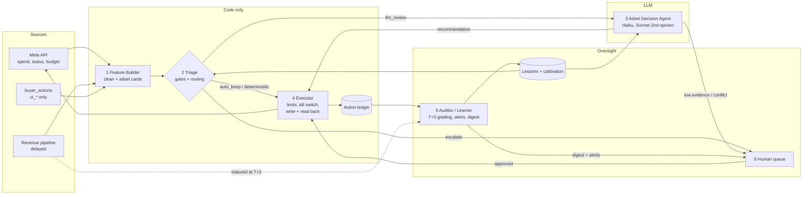

# ARCHITECTURE: the agent army (POC)

Task B. This design is built from what Task A found ([INVESTIGATION.md](INVESTIGATION.md)): the old rules were mostly not short of judgment. They acted on revenue that hadn't arrived yet, ruled on cents of noise, ignored buyers who had just acted, and failed silently. Every major choice below points back to a finding (§ = INVESTIGATION section) or to a sizing number (S<n> = [out/arch_sizing.txt](out/arch_sizing.txt), produced by [src/arch_sizing.py](src/arch_sizing.py)).

## Summary

- **Six components; only one makes judgment calls with an LLM.** Code ingests the data, builds a compact card per adset, routes it, enforces limits, and writes to Meta. The LLM (the Adset Decision Agent) only *recommends*, and only for the cards code routes to it. A separate Auditor grades decisions 3 days later, once revenue is complete.
- **3 decision windows a day (10:00 / 14:00 / 20:00), not every 30 minutes,** placed on the revenue-delay curve, so no ROI-based cut is made on morning data.
- **LLM cost ≈ $0.50/day** for six accounts, against a $30/day budget (S6). The budget isn't the binding constraint. Noise, human attention and Meta API calls are.
- **The system is designed for all six accounts and rolled out one account at a time,** starting with ACC-04 in shadow mode.

---

## 1. From findings to design rules

| Finding | Design rule |
|---|---|
| Budget cuts fired early in the morning, when only 69–83% of revenue per $ was visible; 6 of 12 cut an adset at ROI ≤ 0 on a day that ended positive (§1.4, §2, case 4.1) | **Maturity gate.** No negative action based on today's ROI before 12:00 local. Today's ROI is always divided by the delay factor (0.69 / 0.83 / 1.00 by hour) and blended with matured history: `w = spend / (spend + $20)`, the same blend as in the Task A impact model |
| R04 fired on a median of $0.57 of spend; its 39 kills judged $32 in total (§3.4) | **Materiality gate.** Below a minimum amount at stake, code keeps the adset and does not call the LLM. Day-1 losers mostly stop spending on their own (§3.6) |
| Rules overrode budgets a buyer had set hours earlier (cases 4.1, 4.3) | **Buyer lock.** For 24h after a human `ui_*` action on an adset, the agent may only propose |
| The undo rule failed 8 times silently; a 14h token outage left 27 actions unapplied (§1.1, case 4.2) | **Execution is verified.** Token check before each cycle, read-back after each write, escalation after the first failure |
| Rules named "all accounts" acted on one account (§1.3) | **Scope is config,** plus a daily coverage audit: accounts and adsets in scope vs actually evaluated |
| Rule log records budgets one change behind; 2.8 firings per kill (data issues 7, 9) | **Own action ledger** (budget read from Meta before and after each write) + **idempotency key** (adset, action, window) |
| Metadata budget is 100× real; `effective_status` misleading; buyer log is not purely human (issues 5, 6, 15) | Fixed once, in the Feature Builder: budget ÷ 100, `delivery_status` for "active", only `ui_*` counts as human |
| Losers that ran are mostly not a rules problem (§3.6); the mandate is to keep spend and profit up | Don't design for "kill more". Add a **spend floor** so the system can't shrink its way to a good ROI |

### Scale that shapes the design (S1–S5, S7)
- **Adsets:** 200–320 adsets spend on a given day; 50–210 of them are on day 1 (S1).
- **Money:** ~$1,300/day spend in total and ~$125/day profit for the whole portfolio.
- **Spend concentration (S2):** the median adset-day spends **$1.47**.
  - ~44 adsets/day spend ≥ $5 and carry 72% of spend.
  - ~10 spend ≥ $20 and carry 47%.
  - ~4 spend ≥ $50 and carry 34%.
- **Active budgets (S5):** 292 of 305 active adsets have a budget under $20/day. Only 1 is ≥ $100.
- **Buyers (S4, S7):** ~120–175 `ui_*` actions a day, touching ~70 adsets that hold **55% of spend**. Notes on 24 rows of ~1,000.

So the real decision load is a few dozen adsets a day, plus a long tail where code is enough.

---

## 2. Agent topology

```
                ┌──────────────────────── code only ────────────────────────┐
 Meta API  ───► │ 1 Ingest + Feature Builder ──► 2 Triage / Policy Engine    │
 revenue feed ► │   (cleans, builds adset cards)    routes every card:      │
 buyer log ───► │                                   auto_keep │ deterministic│
                └────────────────────────────────── │ llm_review │ escalate ─┘
                                                     ▼              ▼
                                   3 Adset Decision Agent (LLM)   6 Human queue
                                      recommends only                │
                                                     ▼              ▼
                                   4 Executor (code): limits, kill switch, write, read back
                                                     │
                                                     ▼
                                   ledger ──► 5 Auditor / Learner (T+3 grading, digest, alerts)
                                                     │
                                         lessons + calibration ──► back into 2 and 3
```

| # | Component | What it is | What it can do | Model |
|---|---|---|---|---|
| 1 | **Ingest + Feature Builder** | Pulls and cleans data, applies every Task A data fix, builds one **adset card** per adset (§6.3) | Read data sources; write cards | None |
| 2 | **Triage / Policy Engine** | Sends each card down one route: `auto_keep` · `deterministic` (clear-cut, e.g. day-3+ with $0 matured revenue) · `llm_review` · `escalate`. Applies the maturity and materiality gates and the buyer lock | Route cards; nothing else | None |
| 3 | **Adset Decision Agent** | The judgment layer (the Task C slice). Reads one card and returns an action with confidence and reasoning | **Recommend only.** No write access | Haiku 5.5 for routine cards; Sonnet 5.5 for budget ≥ $50/day, low Haiku confidence, or conflict with a buyer |
| 4 | **Executor** | The only component that writes to Meta | Check hard limits, kill switch, buyer lock and idempotency → write → read back → ledger. Can reject a recommendation | None |
| 5 | **Auditor / Learner** | Grades decisions at T+3; updates lessons and calibration; checks coverage; sends alerts and the daily digest | Write lessons, calibration, alerts, digest. No access to Meta | Code, plus 1 Sonnet call a day to write the digest |
| 6 | **Human approval queue** | Slack/UI. Escalations and anything above autonomy limits | Approve / reject / edit. Each item has a default action if nobody answers by the next window (default = `keep`) | — |

**Why many components and not one agent:** one agent would hold write access, enforce its limits from a prompt, and grade its own decisions. All three are failures Task A documented. Splitting it up gives:
- **The LLM can't argue past a limit.** Limits live in the Executor's code, not in a prompt.
- **Nothing fails silently.** Every write is read back and logged in the ledger.
- **The agent doesn't grade itself.** The grader (5) doesn't share the decider's (3) context or incentives.

The split also keeps the LLM's job small and well-defined: one card in, one structured decision out. That is the cheapest and most testable form.

### Glossary
- **Adset card:** a ~40-line JSON summary of one adset, built by code. It is the only thing the LLM reads about that adset (§6.3).
- **Window:** one of the 3 fixed decision times a day (§3).
- **T+3:** 3 days after the decision day. By then revenue for that day is effectively complete (§2: ~0.1% arrives later), so the decision can be graded.
- **Buyer lock:** for 24h after a human `ui_*` action on an adset, the agent may only propose for that adset, never execute.
- **`llm_review` vs `escalate`:** with `llm_review`, the LLM decides and the Executor acts within limits. With `escalate`, a human decides and nothing runs until they answer.

---

## 3. Cadence

| When | What runs | Why |
|---|---|---|
| **Hourly** (code only) | Pull today's spend/revenue (one batched insights call per account), refresh cards, spend pacing, token health, kill-switch triggers, alert checks | Cheap monitoring; catches runaway spend and outages in under an hour |
| **10:00 window** | Decisions backed by matured history only: multi-day losers, scale-ups on proven winners | Revenue per $ is only ~0.69–0.83 of its final value before noon (§2). This is when the rules made their worst calls |
| **14:00 window** (main) | Full decisions, including today's ROI (delay-corrected) | Revenue per $ ≈ final by 12:00 (§2) |
| **20:00 window** | Budgets for tomorrow, end-of-day cleanup | A near-complete day; budget changes take effect for tomorrow's delivery |
| **Nightly** | Finalise matured days, refresh peer stats and the delay curve, T+3 grading, lessons and calibration update | Learning runs on complete data only |
| **08:30 daily** | Digest to humans (§7.3) | Before the 10:00 window, so humans can clear approvals and set locks |

The old rules evaluated every 30 minutes, which gave them more chances to act on noise. The agent decides at 3 windows a day and monitors with code in between.

---

## 4. Decision boundaries

Thresholds are set for this portfolio (§1 scale). They are config values, not code, and the Auditor may tune them only inside these bounds.

### Autonomous (the Executor runs them without a human)
- **Budget change:** at most ±20% and at most $50 per action. At most 1 change per adset per window, and 2 per day.
- **Pause:** only if the budget is < $20/day **and** the adset made a matured loss on ≥ 2 days.
- **Per account per day:**
  - net budget added ≤ +10% of trailing-7-day daily spend;
  - budget paused or cut ≤ 15% of trailing-7-day daily spend.
- **Per window, for the whole system:** at most 40 executed actions. A loop or a bad config can't do more damage than that in one window.

### Needs human approval
- Any action on an adset with a budget ≥ $100/day. Today that's 1 adset, which carries 18% of spend on its days (S2, S5).
- Pausing an adset that had any profitable matured day in the last 3.
- A budget change > 20%, and any reactivation.
- Anything on an adset under a buyer lock.
- Any card with a critical data-quality flag (§8).
- Any recommendation where code-computed evidence is "insufficient" (§7.1).

### Forbidden in the POC
- Creating, duplicating or deleting campaigns or adsets. Changing bid strategy, targeting or creative.
- Any account or adset outside the scope config.
- Negative actions based on today's ROI before 12:00 local.
- Acting on data more than 2h old. If the latest pull is stale, the system switches to recommend-only until fresh data arrives.
- Acting with no LLM budget left. The system falls back to code-only `keep` plus the deterministic route; urgent cases go to a human.

---

## 5. Economics

### 5.1 LLM cost per day (S6)
Prices per million tokens (input / output): Haiku 5.5 $0.10 / $0.50, Sonnet 5.5 $2 / $10, Opus 5.5 $4 / $20. Cache reads cost 0.1× input.

| Call | Volume/day | Tokens per call | Model | $/day |
|---|---|---|---|---|
| Routed cards | 3 windows × ~60 = 180 | 2,500 cached policy prompt + 1,200 card/peers/lessons in; ~600 out (incl. thinking) | Haiku 5.5 | $0.08 |
| Second opinions | ~20 | same in; ~1,500 out | Sonnet 5.5 | $0.36 |
| Daily digest | 1 | 8,000 in / 2,000 out | Sonnet 5.5 | $0.04 |
| **Total** | | | | **≈ $0.47** |

- **Why ~60 routed cards per window:** ~44 adsets/day spend ≥ $5 (S2), plus ambiguous cards just under the line. That is generous on purpose; the real number is set by Triage.
- **Stress test:** run on every spending adset at every window (~900 calls), the cost is $0.40/day with Haiku, $16/day with Sonnet and **$32/day with Opus, which breaks the budget** (S6).
- **What that means for model choice:** the Haiku tier carries the volume and Sonnet is reserved for second opinions. The headroom under $30 is spent on more Sonnet coverage, not on a bigger model for everything.

### 5.2 Where no model is used at all
Every step that has a right answer runs as code or SQL:
- ingest, cleaning and data fixes;
- feature building and peer stats;
- triage gates, decision limits and the Executor;
- monitoring, alerts and the kill switch;
- T+3 grading.

Using the LLM in any of these steps would add cost and nondeterminism without adding judgment.

### 5.3 Cheap vs expensive model
- **Haiku 5.5:** routine cards where the evidence points one way, which is most of the volume.
- **Sonnet 5.5:** the cases where a wrong call costs real money or overrides a person. That means budget ≥ $50/day (~4 adsets carrying 34% of spend, S2), Haiku confidence below the calibration threshold, or disagreement with a buyer. Sonnet also writes the digest.
- **Opus:** not used in the POC. The stress test shows it can't cover the volume within budget, and nothing in this portfolio needs it per decision.

### 5.4 When does this beat a media buyer's salary?
- **Assumption:** a buyer costs ~$6,000/month fully loaded ≈ **$270 per working day**. This is adjustable; the conclusion holds across any realistic salary.
- **System running cost:** ≈ $0.50/day LLM + ~$5/day hosting (small VM + database; assumption) + **human oversight**.
  - Oversight is about 15–25 escalations/day (assumption, to be measured in shadow week) × ~2 min ≈ 30–50 min of a buyer's day.
  - So the dominant cost is human review time, not tokens.
- **Scaling:** LLM cost grows with *cards routed*, not with spend.
  - At today's mix that's ~$0.0016 per spending adset per day.
  - The $30/day cap covers ~60× today's volume (30 / 0.47).
  - A buyer's cost grows with headcount.
- **Break-even:** the system pays for itself as soon as it removes ~2% of one buyer's day ($5.50 / $270), which is true at any scale where it takes over real work.
  - The honest caveat: the whole portfolio makes ~$125/day profit (S1), less than one buyer costs. So **at this scale the case is headcount and hours saved, not profit uplift.** Task A found the rules' measurable harm was only $26–$41 for the week.
  - The profit case grows with spend, because the same guardrails then protect larger budgets.

---

## 6. Data flow

### 6.1 Who sees what
Principle: **only the Feature Builder touches raw tables.** Every other component gets a narrow, derived input sized to its job.

| Component | Sees | Does not see | Frequency |
|---|---|---|---|
| 1 Feature Builder | All five sources, raw | — | perf: hourly (today's partial day) · metadata: daily + after each write · buyer_actions: incremental, hourly · rule_executions: hourly, transition only · auto_rules: on change |
| 2 Triage | Cards + scope/threshold config + buyer-lock list + data-freshness timestamp | Raw tables | Each window |
| 3 Decision Agent | **One card** (its adset only) + peer stats for its segment + only the lessons matching its segment (capped at ~5; tunable) | Raw tables, other adsets, rule logs, targeting/bid fields | Each window, routed cards only |
| 4 Executor | The recommendation + **live** budget/status read from Meta + limits + ledger + kill-switch flags | Performance data, reasoning | Per recommendation |
| 5 Auditor | Ledger + matured perf at T+3 + `ui_*` buyer actions (to spot when humans reversed the agent) + rule_executions (transition only) | Today's partial-day data | Nightly; the digest LLM sees only the aggregated summary table |
| 6 Human queue | The card, the agent's reasoning, the proposed action, the default if unanswered | — | On escalation |

### 6.2 What each source becomes

| Source | Pulled / cached / on demand | Becomes |
|---|---|---|
| `daily_adset_performance` | Today: **pulled hourly**, one batched call per account (rate limits). Prior 7 matured days: **cached nightly** | Spend/revenue seen, delay-corrected ROI, 3 matured days, trend, age bucket, peer stats |
| `campaign_adset_metadata` | **Cached daily**; **on demand** after any write | Budget (÷ 100), active = `delivery_status`, buyer/vertical parsed from names |
| `buyer_actions` | **Pulled incrementally** each hour | Last human action (time, direction, note), buyer lock, override detection |
| `rule_executions` | Transition only, hourly | "A rule already acted on this adset today" → agent stands down; replaced by the agent's own ledger once rules are off |
| `auto_rules` | On change | Which rules are still live in which scope (no double-acting during transition) |

### 6.3 From raw tables to a decision-ready card
The LLM never sees a table. It sees this (abridged; ~40 lines in full; values are illustrative, modelled on the case 4.1 adset):

```json
{
  "adset_id": "31302925337341", "account": "ACC-04", "window": "14:00", "age_spend_days": 4,
  "budget": {"current": 254.00, "utilization_today": 0.62, "last_change": {"by": "human_ui", "hours_ago": 9, "to": 254.00}},
  "today": {"spend": 158.4, "roi_seen": -0.04, "delay_factor": 1.00, "roi_corrected": -0.04, "share_of_day_elapsed": 0.58},
  "matured_days": [{"d": -1, "spend": 320, "roi": 0.00}, {"d": -2, "spend": 216, "roi": 0.50}],
  "blended_roi": 0.11, "blend_weight_own": 0.89,
  "peers": {"segment": "ACC-04 / age 4+ / ROI band 0", "n": 23, "fwd_roi_1_3d": 0.08},
  "locks": {"buyer_lock": true, "lock_expires_in_h": 15},
  "evidence": {"matured_days": 2, "spend_vs_K": 7.9, "peer_n": 23, "sufficient": true},
  "data_quality_flags": [],
  "lessons": ["L-012: early-day cuts on 4+ day adsets with positive 3-day history were wrong 4/5 times"]
}
```

What happens to the data before it reaches the card:
- **Aggregation:** raw rows → per-adset daily totals, deduplicated (issue 1).
- **Correction:** today's ROI is divided by the delay factor and blended with matured days.
- **Comparison:** peers come from the same account, age bucket and ROI band.
- **Labelling:** a human touch is reduced to its last event plus the lock state.
- **Flags:** data quality is checked before the card is built (§8).

### 6.4 How buyer history is used, and its risks
**What it's used for:**
- **Locks:** don't override a deliberate human call (cases 4.1, 4.3).
- **Override signal:** a buyer reversing an agent action is the cheapest early signal that the agent was wrong. It is graded at T+3 like everything else.
- **Context:** notes such as "scaling winner" or "slow ramp per playbook" go on the card when present.

**What it's not used for:** a source of truth for what was right.
- Buyers left 9 sustained losers running (§3.6).
- In case 4.3 the buyer was right.
- Their actions are evidence, not labels.

**Risks and how the design handles each:**

| Risk | Evidence | Handling |
|---|---|---|
| Not purely human | 10 of 48 `update_ad_set_budget` rows are the rule engine (issue 15) | Only `ui_*` counts as human |
| Can't see on/off | No status event type exists (issue 16) | Manual pauses/re-enables come from Meta status reads, not this log |
| Duplicates and gaps | Duplicates, same-second triplicates, coverage starts 06-06 14:00 (issue 17) | Deduplicated; a missing log never means "no human acted" |
| Campaign-level actions | 286 rows with no adset (issue 18) | Become a campaign-level lock flag, not an adset signal |
| Notes are rare | 24 of ~1,000 | Never relied on; used when present |
| Imitation | Learning from buyers copies their habits, good and bad | The Auditor grades both agent and buyer against matured outcomes |

**The lock's reach:** buyers touch ~70 adsets/day, holding 55% of spend (S7). While buyers keep working those adsets, the agent can only propose on most of the money. That is intended for the shadow phase. Once an adset is handed to the agent, a buyer touch on it becomes an override (graded), not a routine lock.

### 6.5 Diagram



---

## 7. Knowing when it doesn't know, learning, and human visibility

### 7.1 Uncertainty: the code says how much evidence exists, the LLM can't override it
The LLM's self-reported confidence is not trusted on its own. Code computes **evidence sufficiency** for every card from:
- own spend vs K = $20;
- the number of matured days;
- the delay factor;
- peer group size;
- whether signals conflict (e.g. today negative and 3-day history positive, or the agent against a buyer).

Then:
- The LLM's confidence is **capped** by that score.
- If evidence is insufficient, a negative action becomes `escalate` or `keep`. It is never executed.
- The decision records *why* it is uncertain (`uncertainty_reasons`), so a human sees the specific gap, not just a low number.

Task C implements this; RESULTS.md will show it on the cases that have no clean answer.

### 7.2 Learning without retraining
1. **Ledger.** Every decision is stored with its card, route, model, prompt version, lessons used, and what actually happened.
2. **T+3 grading** on matured revenue: the decision is compared with the counterfactual (the same methods as Task A §3.1), and with any buyer reversal.
3. **Calibration table** (per segment: stated confidence vs how often the decision was right). It moves the escalation threshold, so a segment where the agent is overconfident escalates more.
4. **Lesson store.** Repeated, segment-specific mistakes become short lessons (e.g. "early cuts on 4+ day adsets with positive history were wrong 4/5"). Each lesson needs ≥ 3 graded cases, and it expires if later grades contradict it.
5. **Bounds.** Learning moves thresholds only inside the §4 limits; widening a limit needs a human.

### 7.3 Daily digest to humans (08:30, Slack + link to the ledger)
Exceptions come first:
1. **Waiting on you:** open escalations, and the default if nobody answers.
2. **Alerts in the last 24h:** routing/escalation spikes, LLM budget pace, kill-switch trips, failed executions.
3. **Yesterday in numbers:** actions by type and account, budget moved, spend and profit vs the 7-day trend, spend-floor status.
4. **Report card:** decisions from T−3 graded on complete revenue (right / wrong / unclear), with the $ impact.
5. **Disagreements:** buyers reversing the agent; the agent proposing against a buyer.
6. **Data issues found:** stale feeds, broken budgets, unknown adsets, scope coverage gaps.
7. **LLM cost yesterday** vs $30.

Code computes every number. Sonnet only turns the summary table into readable text and never sees raw data. If that call fails, the table is sent as it is.

### 7.4 How the agent is measured (detail in RESULTS.md)
- **Headline metrics:** **matured absolute profit and spend** vs a holdout or counterfactual, graded at T+3.
- **Not a headline metric:** ROI. Pausing everything maximises ROI and destroys the business.
- **Supporting metrics:** human-override rate, escalation rate, and calibration (does 0.8 confidence mean right 80% of the time?).

---

## 8. Failure modes, guardrails and the kill switch

### Top 5 ways this system loses money or breaks

| # | Failure | How it would happen | Guardrail |
|---|---|---|---|
| 1 | **Acting on immature revenue** | Morning ROI looks negative because revenue hasn't arrived; the agent cuts a winner (case 4.1) | Maturity gate; delay-corrected and blended ROI; the 10:00 window allows only history-backed actions; no ROI-based negative action before 12:00 |
| 2 | **Silent execution failure** | Token expires, writes fail, nobody knows; an undo never lands (case 4.2) | Token health check before each cycle; read-back after every write; escalate on the **first** failure; a pending-actions queue shown in the digest; ≥ 2 auth errors in a cycle trips the kill switch |
| 3 | **Fighting the buyers** | The agent overrides a deliberate human call; the buyer reverts it; attention is wasted (case 4.3) | Buyer lock; only `ui_*` counts as human; disagreements escalate instead of executing; buyer overrides are graded |
| 4 | **Runaway spend or an action loop** | A hallucinated budget, repeated scale-ups, a config typo | Executor hard caps (±20%, $50, per-account +10%/day, 40 actions/window); idempotency key; the amount is validated against the live Meta budget, never the LLM's copy |
| 5 | **Shrinking for ROI** | The agent keeps pausing and cutting; ROI looks great while spend and profit fall | **Spend floor:** account spend must stay ≥ 85% of the trailing-7-day level unless a human approves; ≤ 15% of spend paused or cut per day; the Auditor reports absolute profit and spend, not ROI |

**Also guarded:** bad or stale data (×100 budgets, a frozen feed, unknown adset IDs). Validators in the Feature Builder flag the card or block the cycle, and data older than 2h means recommend-only.

### Cost and volume alerts (code, every window, to a human on Slack)
- **Routing spike:** `llm_review` count in a window is > 1.5× the trailing-7-day median for the same window, or > 30% of all cards. The alert says *which triage rule* sent the extra cards, which tells a human whether a threshold is unclear or the market really moved.
- **Escalation spike:** the same check for `escalate`, so humans aren't flooded.
- **LLM budget pace:**
  - 50% of $30: a line in the digest.
  - 80% ($24), or when the pace projects past $30 by end of day: alert a human.
  - 100%: hard stop. The rest of the day is code-only plus `keep`, and urgent cases go to a human.

### Kill switch

| Level | Trigger | Effect |
|---|---|---|
| Global | A human sets the flag (one command / Slack button) | The Executor checks it before **every** write. The system switches to recommend-only: cards and recommendations continue, nothing is written |
| Per account | A human, or an automatic trip scoped to one account | Same, for that account only |
| Automatic | ≥ 2 OAuth/API errors in a cycle · data > 2h old · account spend deviating > 30% from its pace · action count over its cap · LLM budget hit | Recommend-only, plus an immediate alert with the trigger and the last 10 ledger rows |

Resuming always needs a human. State is frozen and nothing is rolled back automatically, because an automatic rollback is just another unreviewed action.

---

## 9. Scope and rollout

**Design for all six accounts, roll out one at a time:**
- The brief asks the system to replace *buyers*, and they work every account.
- ACC-04, the only account the rules touched, is 29% of spend and has 73 of 666 `ui_*` actions (S3). Most buyer work is in ACC-02 and ACC-06.
- The $30 budget and the rate limits are stated across all six.

A design that only covered ACC-04 would repeat finding §1.3. Because scope is config, adding an account is a config change.

| Phase | What | Exit criterion |
|---|---|---|
| Week 1: shadow, ACC-04 | Recommend only. Compare with what buyers and rules actually did, grade at T+3 | Graded week; calibration table exists; no unexplained alerts |
| Week 2: limited autonomy, ACC-04 | Autonomous only for adsets with budget < $20; everything else proposes; rules off for agent-owned adsets | Matured profit and spend ≥ baseline; override rate falling |
| Week 3+: other accounts | Each new account starts with its own shadow week, then limited autonomy | Same criteria, per account |
| Later | Caps raised only where calibration data supports it | Human sign-off |

---

## 10. What this design deliberately does not do
- **No campaign creation or duplication** ("duplicate winners" is in the buyers' job). It is the highest-risk action and the hardest to undo; it stays human in the POC.
- **No bid or creative changes.** The data has 1 bid-strategy event in a week and no creative data.
- **No real-time reaction.** Hourly monitoring and 3 windows a day are enough at this spend level and respect the rate limits.
- **No learning from buyers as ground truth.** See §6.4.
